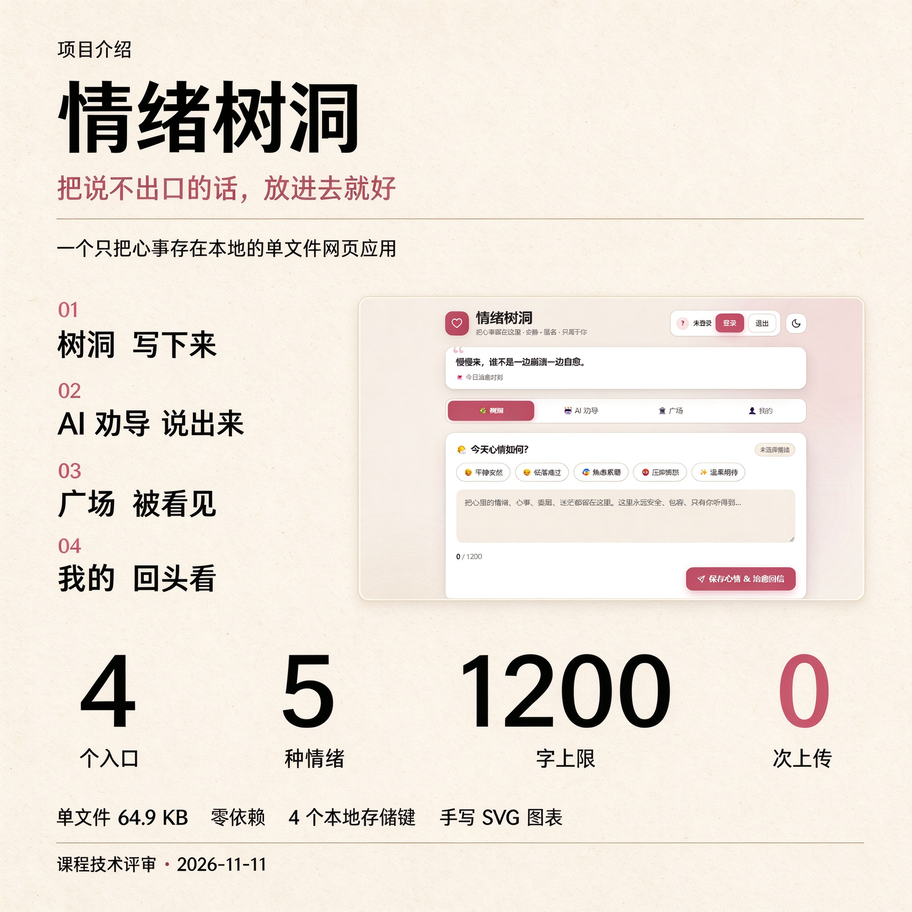
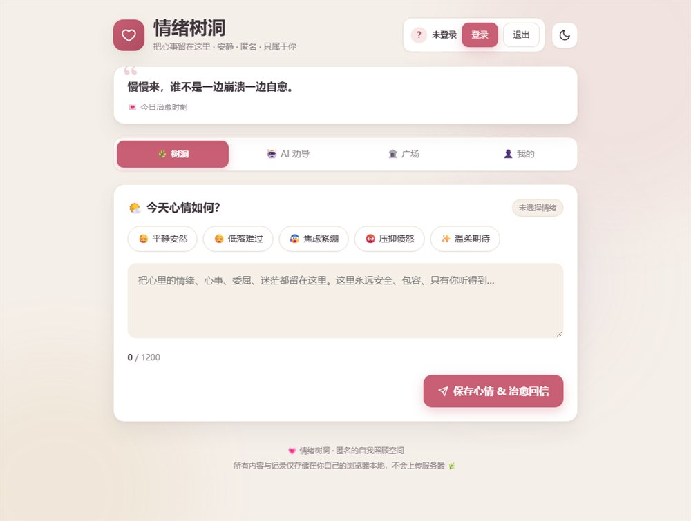
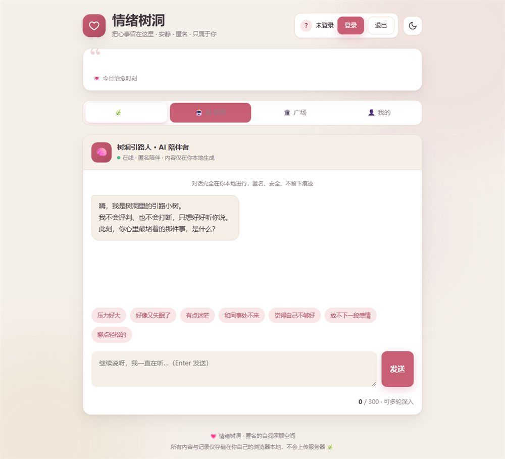
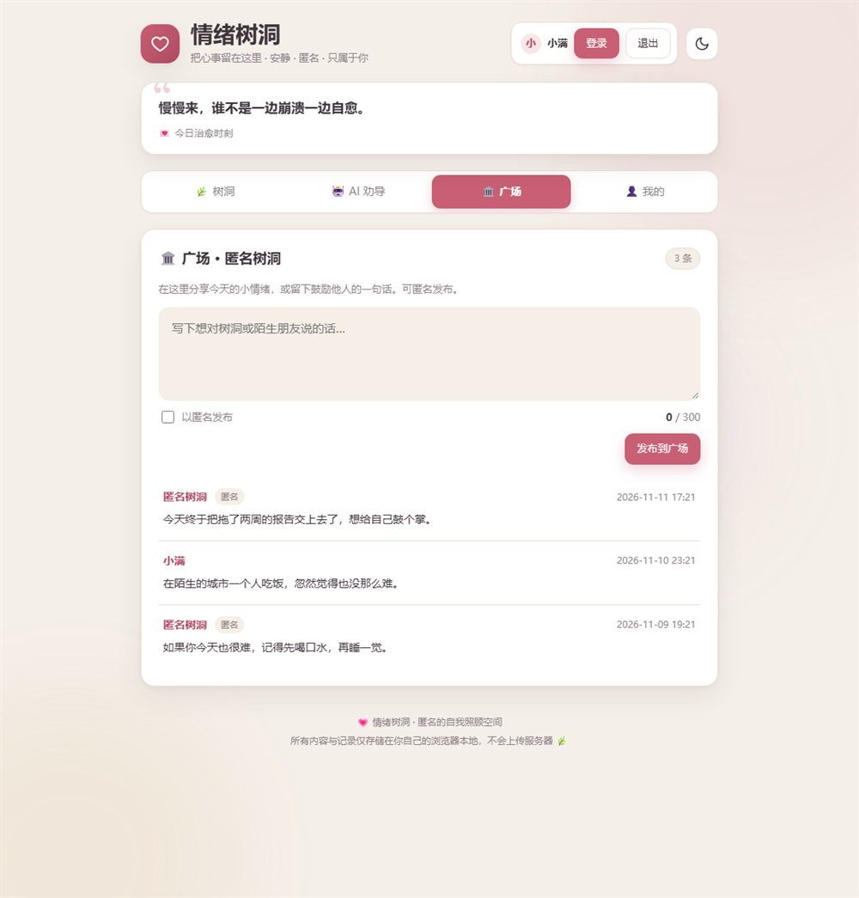
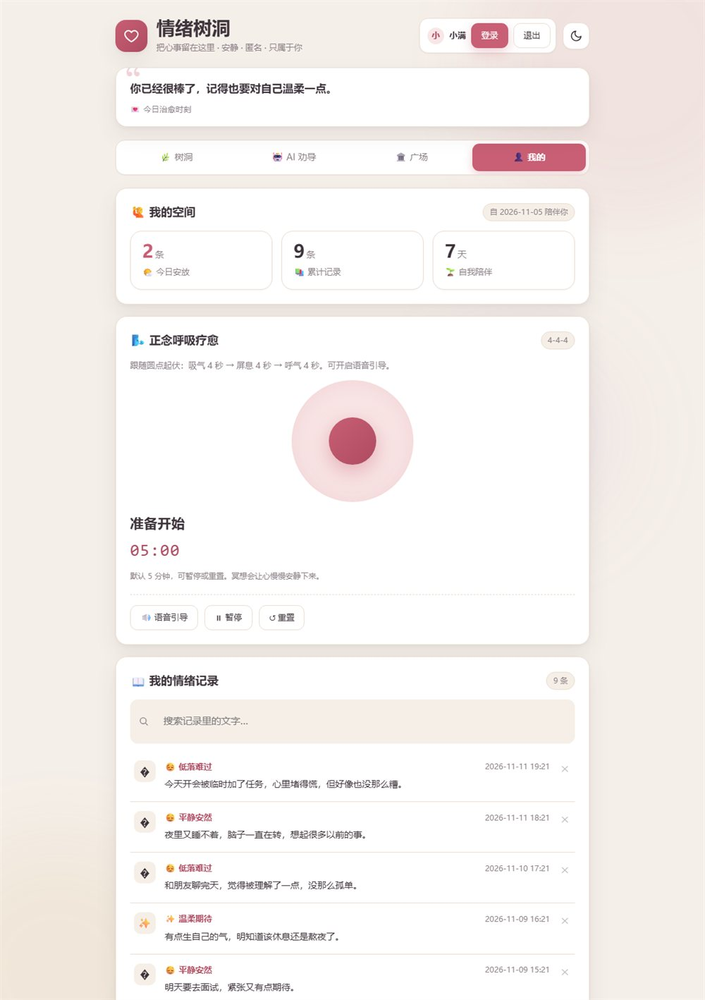

# 情绪树洞 · 治愈所有不安

一个**只把心事存在本地**的单文件情绪倾诉网页应用。写下心事、被温柔接住一次、再回头看见自己的情绪走向。

- 单文件 `index.html`：73,778 字节，零外部依赖、零网络请求
- 数据全部留在浏览器 localStorage：不上传、不联网、可导出、可清空
- 四个入口：树洞 / AI 劝导 / 广场 / 我的



---

## 项目介绍

做这个页面的起点是一个很具体的场景：凌晨两三点，人很累但睡不着，想找个人说话，又不想让任何人知道。

所以这个应用不追求"功能多"，只守三条底线：

1. **说得出口**：不选情绪也能直接写，不知道写什么时有 7 个快捷话题可选。
2. **有人接住**：写完立刻得到一段回应，不是"已提交"三个字。
3. **退得回来**：所有记录只在自己这台设备上，随时可以导出成 JSON，也可以一键清空。

它被刻意做成一个可离线、可分发、可演示的单机版本——双击 HTML 就能用，不依赖服务器、账号体系或网络。

---

## 界面预览

| 树洞 · 写下心事 | AI 劝导 · 被接住 |
|---|---|
|  |  |
| **广场 · 被看见** | **我的 · 回头看** |
|  |  |

---

## 功能清单

**树洞**
- 五种情绪标签：平静安然 / 低落难过 / 焦虑紧绷 / 压抑愤怒 / 温柔期待
- 心声输入上限 1200 字，实时字数计数
- 只点情绪不写字也能提交；空内容提交会被拦下并给出提示
- 提交后弹出「已安放，愿你好受一些 🌿」，并把页面滚到自己的记录处
- 顶部语录卡 6 秒自动轮播 6 条治愈短句

**AI 劝导（引路小树）**
- 7 类话题识别：压力 / 睡眠 / 漂泊 / 关系 / 自我价值 / 告别 / 轻话题
- 每类话题两段式回应：`first` 4 句先接住情绪，`deep` 4 句给具体做法
- 关键词未命中时落到「轻话题」，不会冷场
- 回复前有 700–1200ms 的「正在输入」停顿，模拟真人在打字
- 单条输入上限 300 字

**广场**
- 发布留言，可勾选「匿名发布」
- 匿名时昵称固定为「匿名树洞」，实名时显示当前用户名
- 发布需登录，未登录会引导登录
- 留言按时间倒序排列，单条 300 字

**我的空间**
- 今日记录数 / 累计记录数 / 陪伴天数
- 正念呼吸训练：4-4-4 节奏（吸气 4 秒 — 屏息 4 秒 — 呼气 4 秒），共 300 秒
- 呼吸引导带中文语音朗读（`speechSynthesis`，语速 0.9）
- 情绪记录列表，可逐条删除；清空需二次确认
- 记录导出为 JSON 文件（`Blob` + `URL.createObjectURL`）

**图表**
- 近七日记录数柱状图，用 `<line>` 手绘，只标关键高度、不画网格线
- 情绪分布环形图，用 `stroke-dasharray` 拼扇区
- 图表只做描述性统计：不预测、不打分、数据不足时留空

**其他**
- 深色主题：跟随 `prefers-color-scheme`，也可手动切换，状态存 `mood-theme`
- 原生 `<dialog>` 弹窗：登录 / 注册 / 删除确认 / 清空确认
- 响应式布局，窄屏自动收窄留白

---

## 页面结构与路由

四个 tab 对应四个面板，通过顶部 `hash` 映射切换，切换时用 class `on` 控制显隐：

```text
# home     树洞：语录卡 + 情绪选择 + 心声输入 + 提交
# advise   AI 劝导：引路小树对话 + 快捷话题
# square   广场：发布框 + 留言流
# me       我的：统计卡 + 正念呼吸 + 记录列表 + 图表
```

- 只有「广场」和「我的」在切入时才重新渲染（数据来自 localStorage，需现取现画）
- 直接改动 `location.hash` 即可切 tab，无需点击

---

## 技术实现

| 项目 | 做法 |
|---|---|
| 形态 | 单个 HTML 文件，样式与逻辑全部内联，双击即用 |
| 依赖 | 无框架、无构建、无 CDN、无网络请求（源码中 `fetch(` 出现 0 次） |
| 作用域 | 全部逻辑包在一个 IIFE 闭包里，不污染全局 |
| 存储 | localStorage 4 个键，读写封装为 `read(key, fallback)` / `write(key, val)`，JSON 解析失败回落默认值 |
| 状态 | `records / users / board / currentUser / selectedMood / voiceOn / deleteId` 等变量集中在一处，改完统一重渲染 |
| 图表 | 手写 SVG：柱状图 `<line stroke-width>` 当柱，环形图 `stroke-dasharray` 拼扇区，颜色由 `moodColor()` 统一映射 |
| 密码 | djb2 变体哈希：`h = 5381`，`h = ((h << 5) + h) + charCodeAt(i)`，返回 `'h' + abs(h)`，无盐 |
| 导出 | `Blob` + `URL.createObjectURL` 生成 JSON 下载，不经过服务器 |
| 语音 | `SpeechSynthesisUtterance`（`lang=zh-CN`，`rate=0.9`）朗读呼吸引导 |
| 弹窗 | 原生 `dialog.showModal()`，不引第三方模态框 |

### 数据结构

```jsonc
// coze-mood-tree-v1：情绪记录
[{ "id": "m0x8k3ab12", "owner": "小满", "mood": "😌 平静安然", "text": "今天终于把那个报告发出去了。", "ts": 1762819200000 }]

// coze-mood-users-v1：本机账号
[{ "name": "xiaoman", "nick": "小满", "pass": "h123456789", "created": 1762732800000 }]

// coze-mood-board-v1：广场留言
[{ "id": "m0x8k9cd34", "name": "匿名树洞", "text": "明天要面试，紧张到胃疼。", "anon": true, "ts": 1762820100000 }]

// coze-mood-current：当前登录用户名（裸字符串）
"xiaoman"

// mood-theme：主题偏好
"dark" | "light"
```

> 键名沿用最初的 `coze-mood-*` 命名，没有改名——改名等于让已经写下过心事的人丢失记录。

### 一次提交链路

```text
点「保存心情」→ 登录校验 → 内容非空校验 → 1200 字长度校验
→ 组装记录 {id, owner, mood, text, ts}
→ records.push() + saveRecords()
→ pickReply(mood, text) 生成回信
→ 清空输入 → renderMe() + renderBoard()
→ 滚动到记录处 + toast 提示
```

---

## 本地运行

不需要安装任何东西：

```bash
# 方式一：直接双击
open index.html        # macOS
start index.html       # Windows

# 方式二：起一个静态服务（推荐，便于测 hash 路由）
python -m http.server 8000
# 然后浏览器打开 http://localhost:8000
```

首次打开是空状态；点「注册」建一个本机账号后即可写心事、发广场留言。

---

## 部署到 GitHub Pages

1. 在 GitHub 新建仓库（例如 `mood-tree-hole`），不要勾选自动生成 README。
2. 把本仓库推到远端：

```bash
git remote add origin https://github.com/<你的用户名>/mood-tree-hole.git
git branch -M main
git push -u origin main
```

3. 打开仓库 **Settings → Pages**：Source 选 `Deploy from a branch`，Branch 选 `main`、目录选 `/ (root)`，保存。
4. 等 1–2 分钟，访问 `https://<你的用户名>.github.io/mood-tree-hole/`。

因为站点是纯静态单文件，Pages 不需要任何构建配置。注意：记录仍然只存在访问者的浏览器里，服务器上没有任何数据。

---

## 工程目录

```text
mood-tree-hole/
├── index.html                   # 单文件应用（全部代码在此）
├── docs/
│   ├── poster.jpg               # 项目介绍海报
│   └── screenshots/             # 四个入口的真实界面截图
│       ├── 01-home.jpg
│       ├── 02-advise.jpg
│       ├── 03-square.jpg
│       └── 04-me.jpg
├── README.md
└── .gitignore
```

---

## 已知边界与设计取舍

**有意为之**
- 不做服务端：换台设备就看不到自己的记录，这是"心事只留在这台机器"的代价。
- 不做情绪评分：一张"情绪健康指数"会把自我觉察变成 KPI，所以图表只描述、不评判。
- 呼吸用 4-4-4 而不是更"有效"的 4-7-8：屏息 7 秒对新手太长，第一次跟不上就会直接退出。

**尚未实现**
- 「广场」本质是本机数组，看不到别人的留言
- 劝导是预设话术表 + 关键词匹配，不是大模型对话
- 密码哈希无盐、明文结构存本地，只适用于单人本机场景

**下一步**
- 接入服务端：跨设备同步、真实广场、真正的模型对话
- 数据加密与本地口令保护
- 记录迁移（导入 JSON 恢复）

---

## 更新日志

- `feat` 单文件页面：四个入口、五种情绪、1200 字心声提交
- `feat` 引路小树：7 类话题话术表 + 「正在输入」节奏
- `feat` 广场与我的空间：留言、匿名、统计、记录列表
- `feat` 手写 SVG 情绪图表与正念呼吸 4-4-4
- `feat` 深色主题、语录轮播、JSON 导出与清空确认
- `docs` 项目海报、四张界面截图与 README

---

本仓库为课程 / 技术评审汇报用途的演示项目，记录只存在本地浏览器，不含任何真实用户数据。
